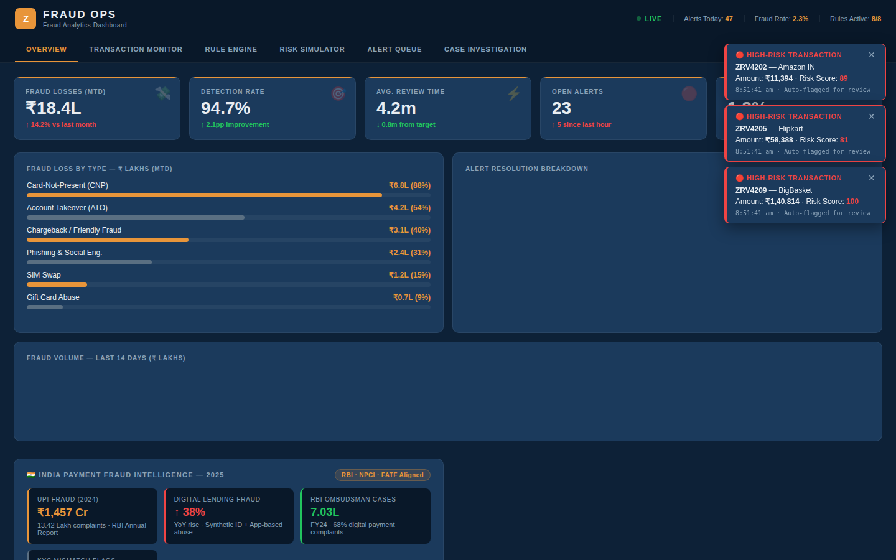

# Fraud Analytics Dashboard (Interactive Demo)

**Status:** Deployed as an illustrative simulation · Independent open-source project

**Documentation:** [LICENSE](./LICENSE)

Maintained by **Gururaj G J** — Senior Fraud Risk | Merchant Risk | Financial Crime Professional
[LinkedIn](https://www.linkedin.com/in/gururaj-gj-52a062b4/) · [GitHub](https://github.com/Gururaj-GJ-G)

---

## What it is

A five-tab consulting-style fraud monitoring dashboard, built to illustrate what a deployed
fraud-analytics interface could look like:

- **Overview** — KPIs and summary charts
- **Transaction Monitor** — a simulated live transaction feed (updates every 2.5 seconds)
- **Rule Engine** — 8 toggleable example rules
- **Risk Simulator** — 5 inputs producing a 0–100 composite risk score
- **Alert Queue** — seeded example alerts with Investigate / Dismiss / Escalate actions

## Screenshot

## Important: this is explicitly a simulation

This dashboard is clearly labeled as an interactive demo. It uses `Math.random()` throughout for
the simulated transaction feed, scores, and statuses, and a timed interval to simulate a live
feed. There is no real backend and no real data — every number on screen is generated
client-side purely for demonstration purposes. It's included here as a UI/UX and front-end
engineering sample, not as a claim of a production monitoring system.

## Architecture

A single self-contained HTML file using Chart.js for visualization, with all data simulated
client-side.

## Use cases

A quick, visual reference for what a fraud-monitoring interface can look like — useful in
discussions about dashboard design, alert-queue workflows, and rule-engine UX.

## License

MIT — see [LICENSE](./LICENSE).
